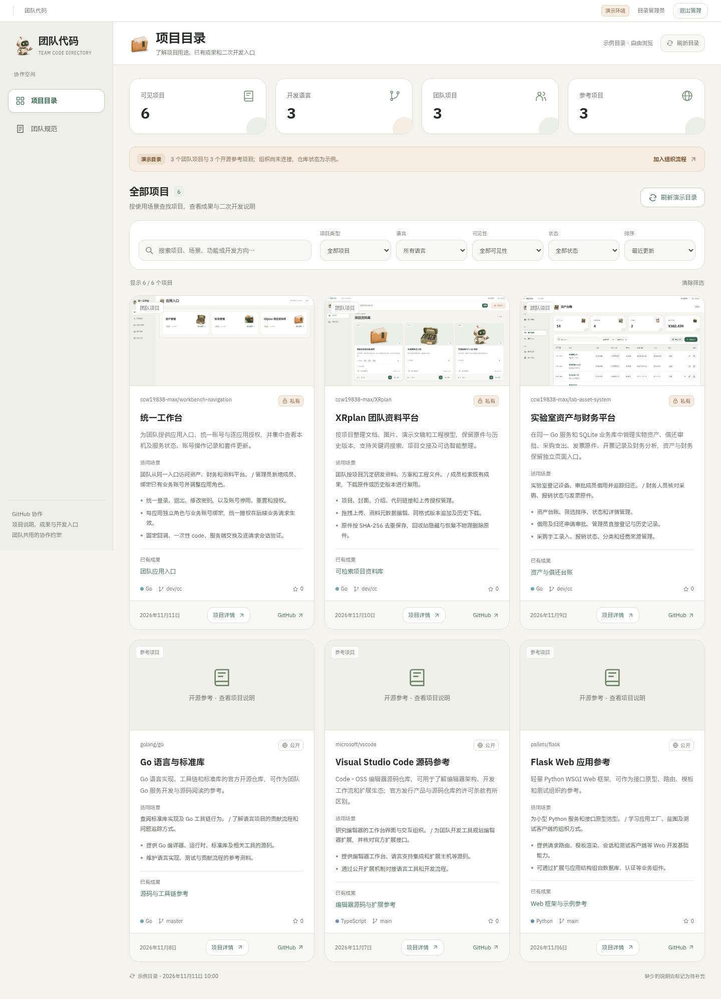

# 团队代码目录

一个独立部署的 GitHub 项目展示与复用入口。集中展示项目的功能、应用场景、成果示例和开发说明，帮助团队成员找到已有代码、复现结果并继续开发。

Go 1.24+ · 原生 HTML / CSS / JavaScript · 单二进制部署 · 桌面界面

[快速开始](#快速开始) · [接入 GitHub](#接入-github-组织) · [项目资料](docs/project-profiles.md) · [团队规范](docs/team-code-rules.md) · [协作模板](templates/README.md)



## 能做什么

| 能力 | 使用方式 |
| --- | --- |
| 找到合适的项目 | 按名称、功能、场景、产出或扩展方向搜索，按项目类型、语言、可见性和归档状态筛选 |
| 理解项目用途 | 查看功能说明、适用场景、维护人、成熟度和当前局限 |
| 查看已有成果 | 浏览脱敏截图和输出说明，了解运行后能得到什么 |
| 开始二次开发 | 查看运行依赖、启动步骤、代码入口、扩展点、验证方法与文档链接 |
| 进入 GitHub 协作 | 跳转到对应仓库查看源码、Issue 和 Pull Request |
| 统一团队约定 | 阅读仓库归属、权限、分支、评审、发布和交接规则，下载项目模板 |

项目基础信息由 GitHub API 提供；功能、成果和二次开发说明由维护者填写确认。没有维护资料的仓库会显示“待补充”。

[功能与成果预览](docs/ui/github-project-detail.png) · [二次开发指南预览](docs/ui/github-project-development.png) · [团队规范预览](docs/ui/github-team-rules.png) · [模板下载预览](docs/ui/github-team-templates.png)

## 快速开始

### 体验 Demo

需要 Go 1.24+ 和 Python 3，在仓库根目录执行：

```bash
python3 scripts/run-demo.py
```

默认地址为 `http://127.0.0.1:18091`。无需 GitHub 组织或令牌，即可浏览六个示例项目、打开详情并体验搜索和筛选。

点击“管理员登录”可体验目录刷新。用户名为 `admin`，脚本生成的随机密码保存在本机 `data/demo/dev-account.json`，文件权限为 `0600`；重复启动沿用已有密码。更改端口使用：

```bash
python3 scripts/run-demo.py --port 18092
```

Demo 包含三个团队项目和三个开源参考项目。功能说明依据对应项目文档整理，截图来自脱敏演示环境；仓库状态、分支、时间和统计为示例数据。入组流程只作本地交互演示。

### 直接运行二进制

仅构建需要 Go；程序运行时无需 Python、Node.js 或数据库服务。

```bash
go build -o bin/github-catalog .
./bin/github-catalog -demo
```

手动启动 Demo 时，未设置管理员密码则仅开放示例浏览。Python 脚本负责构建程序和准备本地演示账号，不是运行依赖。

## 接入 GitHub 组织

先通过部署环境配置以下变量，再启动服务：

| 环境变量 | 用途 |
| --- | --- |
| `GITHUB_CATALOG_ADMIN_PASSWORD` | 本服务的管理员密码，真实模式必填，至少 12 个字符 |
| `GITHUB_CATALOG_TOKEN` | 后端读取 GitHub 的令牌；只展示公开仓库时可留空 |

```bash
./bin/github-catalog -github-org YOUR_ORG
```

`YOUR_ORG` 填组织登录名。团队项目应位于该组织下；加入组织不会自动将成员个人账号的仓库转入组织。

公开目录支持匿名读取。读取私有仓库元数据，推荐使用 GitHub App 安装令牌，首次验证也可使用受限的 fine-grained PAT，授权所需仓库的 `Metadata: read`。令牌由服务端保管，不返回浏览器。

**真实模式下，访客只能看到公开项目；本服务管理员可以查看服务器获准读取的私有项目。** 目前尚未实现成员 GitHub 身份绑定及逐成员仓库权限过滤。

目录缓存 10 分钟，到期后在下次请求时更新；管理员可以手动刷新。当前只读取项目资料，不克隆仓库或保存源代码。安装令牌自动续期、用户授权与组织邀请的接入方案见 [GitHub 组织接入与权限](docs/github-access.md)。

### 启动参数

| 参数 | 默认值 | 说明 |
| --- | --- | --- |
| `-addr` | `127.0.0.1:18091` | HTTP 监听地址 |
| `-public-url` | `http://127.0.0.1:18091` | 浏览器实际访问的源，包含协议、主机和端口 |
| `-demo` | `false` | 使用内置演示数据，不请求 GitHub |
| `-github-org` | 空 | 读取指定组织，与 `-demo` 互斥 |
| `-profiles` | 空 | 真实模式使用的项目资料 JSON 文件 |
| `-navigation-url` | 空 | 可选的外部导航链接 |

在局域网部署时，可使用：

```bash
./bin/github-catalog \
  -github-org YOUR_ORG \
  -addr 0.0.0.0:18091 \
  -public-url http://192.168.1.10:18091
```

其中 IP 为示例，需替换为实际服务地址。`-public-url` 必须与浏览器访问的源一致；使用 HTTPS 反向代理时，填写代理对外提供的源。更新凭据或启动配置后需要重启服务。

### 接入统一导航

与 Workbench Suite 部署在同一服务器时，建议给代码目录使用独立端口 **18092**；套件已将 **18091** 用作 XRplan 的内部端口。配置好本服务的管理员密码及按需提供的 GitHub 令牌后，可运行：

```bash
./bin/github-catalog \
  -github-org YOUR_ORG \
  -addr 0.0.0.0:18092 \
  -public-url http://192.168.9.120:18092 \
  -navigation-url http://192.168.9.120:18080
```

将组织名和示例 IP 替换为实际值；`-navigation-url` 仅提供可选返回链接。导航主页的 `code-zimu` 卡片应指向同一个公开源，成员入口可见性由导航管理员分配，目录自身的管理员登录和 GitHub 仓库权限分别管理。

### 可选：通过导航统一登录

本仓库可单独开发、构建和部署。启用 SSO 后仍保持当前独立界面、端口和进程，浏览器无需再输入目录密码。接入约定见 [SSO v1](docs/sso-contract.md)。

在导航登记 `code-zimu`、自己的公开 URL、固定 `/auth/sso/callback` 和独立 `secret_env`。导航的该凭据与本服务的 `WORKBENCH_CLIENT_SECRET` 取同一随机值（至少 32 字符），分别通过各自环境安全注入。代码服务再配置：

```bash
export WORKBENCH_PORTAL_URL=https://nav.example.com
export WORKBENCH_PUBLIC_URL=https://code.example.com
# WORKBENCH_CLIENT_SECRET 已由环境设置注入，不提交到 Git。
./bin/github-catalog -github-org YOUR_ORG \
  -addr 127.0.0.1:18092 -public-url "$WORKBENCH_PUBLIC_URL"
```

域名替换为实际地址，HTTPS 反代保留公开 Host；本地联调可用自己可达的 HTTP origin。可选 INTERNAL_URL 用于服务端访问导航，不配置 GATEWAY_SECRET。套件导航通过私密 config.json 的 `code_zimu_secret` 和可选 `code_zimu_url` 生成登记信息；代码服务仍由本仓库单独部署。

导航管理员给使用者分配 code-zimu 的 user/admin 授权：user 仅浏览公开目录，admin 可刷新并查看服务器令牌可见的私有元数据。GitHub 仓库的源码权限仍由 GitHub 自己验证。每次请求在线验权，停用/撤权即时生效；“全局退出”撤销其他首方应用会话，不跨源读取导航 Cookie。不同站点的页面在切回前台和每 15 秒重新确认身份。

SSO 启用后旧目录密码与本地 Cookie 均不参与认证，GITHUB_CATALOG_ADMIN_PASSWORD 不再必需；认证服务离线返回 503，不回退本地管理员。所有 SSO 变量均省略时保留原来的独立登录和演示流程，配置不完整则拒绝启动。

单仓库检查使用 `GOWORK=off go test -race ./...` 和 `go vet ./...`，契约单测自带 mock，不需要导航仓库。真实跨应用验收可交付本仓库二进制给导航的 [sso-smoke.py](https://github.com/ccw19838-max/workbench-navigation/blob/dev/cc/scripts/sso-smoke.py)，无需在一个环境共同检出所有源码。

## 维护项目资料

项目详情围绕“能做什么、产出什么、适合谁、如何扩展”组织。维护资料的基本流程：

1. 复制 [项目资料示例](examples/profiles.example.json)，将键改成实际的 `owner/repository`。
2. 填写功能、场景、成果、依赖、启动方法、代码入口、扩展方向和验证记录。
3. 将 JSON 文件保存在服务端的 `web/` 之外，通过 `-profiles` 加载：

```bash
./bin/github-catalog \
  -github-org YOUR_ORG \
  -profiles /path/to/project-profiles.json
```

资料按仓库全名匹配，不能创建 GitHub 中未返回的项目或扩大访问权限。更新文件后重启生效；真实模式默认不使用 Demo 说明。

成果图片目前通过公开静态资源提供，只放置允许公开的脱敏图片。完整字段、数据边界和维护方法见 [项目资料维护](docs/project-profiles.md)。

## 团队代码管理

“团队规范”页面与 [规范正文](docs/team-code-rules.md) 提供建议规则 v0.1，涵盖：

- 团队仓库归组织管理，明确负责人、备用负责人和 Team 权限。
- 沿用项目已确认的协作分支，以短期分支和 PR 完成变更，至少一名非作者评审。
- 功能交付同时更新说明、真实成果和验证记录。
- 发布保留明确版本、构建方法和回滚方案；人员变动时完成项目移交。

规则由团队确认后采纳。GitHub 的分支保护、必需评审和 CI 检查需要由管理员实际配置。

| 模板 | 适合维护的内容 |
| --- | --- |
| [README](templates/README.template.md) | 用途、场景、成果、运行和扩展说明 |
| [CONTRIBUTING](templates/CONTRIBUTING.template.md) | 任务、分支、提交和评审流程 |
| [Pull Request](templates/PULL_REQUEST_TEMPLATE.md) | 变化、验证、文档、风险和回滚 |
| [CODEOWNERS](templates/CODEOWNERS.example) | 按路径指定评审负责人 |
| [发布清单](templates/RELEASE_CHECKLIST.md) | 版本、构建、迁移、上线验证和恢复准备 |

模板也可以在页面下载。使用前替换占位内容，安装位置和注意事项见 [模板说明](templates/README.md)。

## 二次开发

```text
.
├── main.go                   # 启动参数和 HTTP 服务生命周期
├── app.go                    # 管理员会话、访问校验和静态资源
├── github_projects.go        # GitHub API、缓存和目录可见性
├── project_profiles.go       # 项目资料加载与校验
├── demo-profiles.json        # 演示项目资料
├── *_test.go                 # 接口、权限和资料回归测试
├── web/                      # 嵌入式桌面界面、模板和演示图片
├── scripts/                  # 独立启动和浏览器检查
├── docs/                     # 接入、资料维护和团队规范
├── examples/                 # 配置示例
└── templates/                # 团队协作模板
```

后端使用 Go 标准库，前端为原生 HTML、CSS 和 JavaScript，页面与资源编译进二进制。修改 `web/` 后需重新构建程序。

- 调整项目卡片、搜索与详情：`web/projects.js`、`web/projects.css`。
- 调整页面布局与管理员会话：`web/index.html`、`web/base.css`、`web/app.js`。
- 维护团队规范：`web/team-rules.json` 与 `docs/team-code-rules.md`。
- 更新下载模板：同步修改 `templates/` 和 `web/templates/`。
- 扩展项目字段：同步修改 Go 资料结构、校验、界面、示例和文档。

### 验证

```bash
go test -race ./...
go vet ./...
```

先启动 Demo，再运行浏览器检查：

```bash
node scripts/smoke.cjs
```

浏览器检查需要 Node.js、Playwright 和 Chromium。可通过 `PLAYWRIGHT_MODULE` 指定现有 Playwright 安装，通过 `CHROMIUM_PATH` 指定 Chromium 可执行文件；默认浏览器路径为 `/usr/bin/chromium`。脚本验证搜索、详情、成果图片、规范、模板下载、异常恢复及私有资料清除，并更新 `docs/ui/` 的演示截图。

运行数据 `data/`、构建产物 `bin/` 和本地环境文件 `.env` 已排除在版本管理之外。

## 当前边界

- 界面只面向桌面使用。
- 管理员会话与目录缓存在内存中，重启后清空；会话有效期为 8 小时。
- 尚未实现 GitHub 用户登录、组织成员自动邀请和 GitHub App 安装令牌自动续期。
- 入组流程为模拟展示，团队规范为待采纳的协作约定。
- 项目级源码许可证尚待维护者确定；字体和图标的许可分别见 [OFL](web/fonts/OFL.txt) 与 [图标来源](web/icons/SOURCE.md)。
